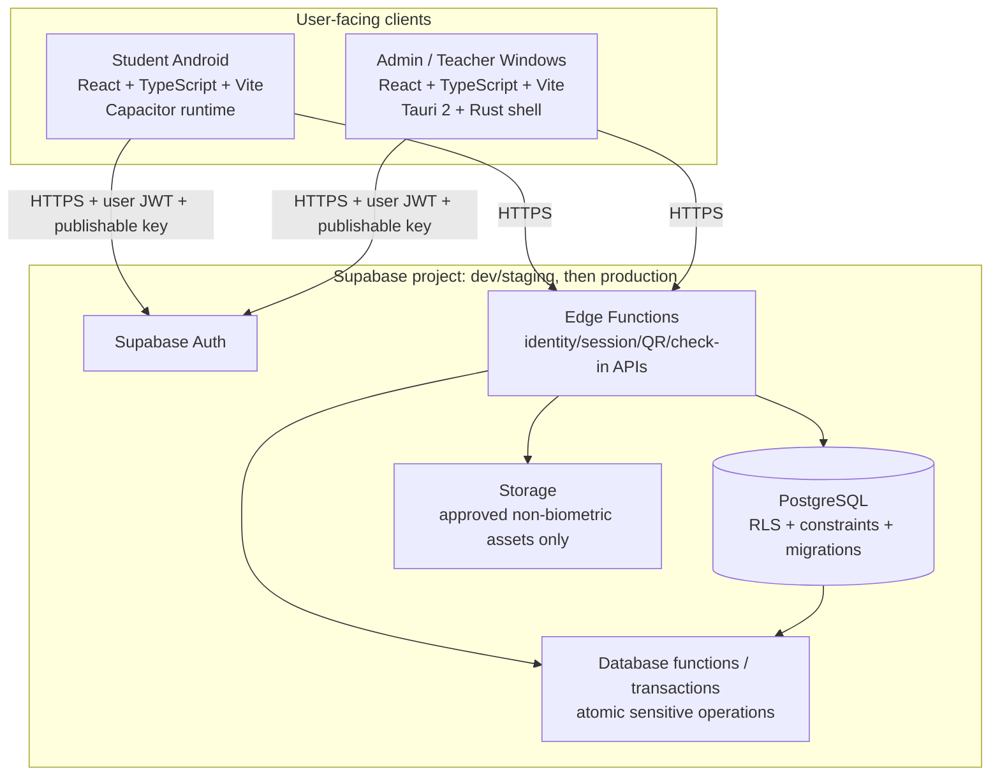

# TRUEMUSTER — System Architecture and Technical Decisions

**Version:** 1.0 · **Date:** 10 October 2026  
**Status:** Selected architecture for planning; repository audit must confirm compatibility before code changes.

## 1. Architecture at a glance



Both clients are untrusted clients. UI hiding, client-side timers, cached statuses or client-supplied booleans do not enforce security. Backend policy is authoritative.

## 2. Selected platform stack

| Layer | Selected direction | Reason / boundary |
|---|---|---|
| Android user interface | React + TypeScript + Vite | Matches current design-to-code strategy and shares typed domain contracts with the desktop app. |
| Android package/runtime | Capacitor Android | Provides a native Android shell and typed bridge to native Java/Kotlin plugins; native hooks needed for device key/auth/location. |
| Windows user interface | React + TypeScript + Vite | Existing Windows Stitch/design docs already describe a separate desktop UX. Do not scale the mobile UI onto desktop. |
| Windows packaging | Tauri 2 + Rust shell | Packages the Windows UI; Tauri capabilities/commands should expose only required native functions. |
| Identity | Supabase Auth + approved roster workflow | Auth verifies account/session; roster eligibility and app role/assignment are separate authorization checks. |
| Database | Supabase PostgreSQL | Relational constraints suit students, courses, assignments, sessions and one-record-per-student/session invariants. |
| Data access | RLS + minimal grants + server functions | Default deny and least privilege; all protected operations verified server-side. |
| Server-side workflow | Supabase Edge Functions plus database-side functions/transactions | Keep custom request validation at the edge and enforce multi-step/atomic invariant at the database boundary. |
| Native phone authentication | AndroidX `BiometricPrompt` + secure device credential fallback | Authenticates use of the phone's local secure authenticator; not face recognition of the enrolled student. |
| Device binding | Android Keystore key pair; server challenge signing | Backend verifies proof from an active registered device key; private key stays on device. |
| Face verification/liveness | Interface-only extension hook, disabled in v1 | No face capture, face matching or liveness dependency is installed or called in v1. |
| Version control | Private GitHub repository | One source of truth, protected main branch, feature branches/PRs or equivalent review workflow. |

**Why not React Native in v1?** The finalized v1.1 requirements explicitly select React + TypeScript + Capacitor/native Android. Re-evaluating React Native would be an architecture change with migration and design reuse implications; do not do it based on a generic recommendation without owner approval.

**Why not MongoDB by default?** Current entities have strong relationships and transactional uniqueness requirements, and the accepted baseline selects PostgreSQL. A MongoDB migration adds operational complexity and weakens the single-source-of-truth story unless the organizer confirms it is mandatory and a concrete justification is approved.

**Why no separate Node.js API server by default?** The selected baseline uses Supabase Edge Functions and database-side transactional functions. A separate Node service can be evaluated if a required SDK/deployment capability cannot be supported in Edge Functions, but it must be an explicit decision—not a duplicated API stack.

## 3. Suggested repository layout

Use this as a target if the audit finds no existing established structure. Preserve a viable existing layout if one already exists; do not mechanically migrate it.

```text
/
├── README.md
├── PLAN.md
├── PRD.md
├── ARCHITECTURE.md
├── ANDROID_UI_IMPLEMENTATION_AND_MOTION.md
├── SUPABASE_BACKEND_AND_DATABASE.md
├── SECURITY_PRIVACY_AND_FUTURE_LIVENESS.md
├── TESTING_AND_ACCEPTANCE.md
├── DECISIONS_AND_OPEN_QUESTIONS.md
├── ANTIGRAVITY_MASTER_PROMPT.md
├── package.json                  # npm workspaces only if selected by the audit
├── apps/
│   ├── student-android/
│   │   ├── src/
│   │   │   ├── app/              # routes/navigation/provider setup
│   │   │   ├── features/          # auth, device, home, attendance, history
│   │   │   ├── components/        # app-specific shared primitives
│   │   │   ├── platform/android/  # typed bridge adapters
│   │   │   ├── services/          # API/application services
│   │   │   └── styles/            # tokens and motion
│   │   ├── android/               # Capacitor native project
│   │   └── capacitor.config.ts
│   └── admin-windows/
│       ├── src/
│       │   ├── app/
│       │   ├── features/          # auth, teacher, sessions, roster, reports, audit
│       │   ├── components/
│       │   ├── platform/windows/
│       │   └── services/
│       └── src-tauri/             # Tauri v2/Rust/capabilities
├── packages/
│   ├── domain-contracts/          # shared DTOs/enums/schema validation
│   └── design-tokens/             # semantic tokens only; no universal screen UI
├── supabase/
│   ├── config.toml
│   ├── migrations/
│   ├── functions/
│   └── tests/
└── docs/
    ├── ui-ux/android/
    ├── ui-ux/windows/
    ├── decisions/
    └── operations/
```

Do not overshare UI components just because both clients use React. Share domain types, API schemas, semantic status definitions, data validation and foundational tokens. Keep mobile navigation, touch ergonomics and camera flow separate from desktop tables, keyboard navigation and dense operational workflows.

## 4. Runtime boundaries

### Android

React UI calls typed application services. Application services call interfaces such as `CameraScanner`, `LocationProvider`, `DeviceAuthenticator`, `DeviceKeyStore` and `AttendanceApi`. Native implementations should be hidden behind typed adapters. Mock implementations are for tests/story/demo mode only and must never be compiled as the production attendance authority.

### Windows

React UI calls typed application services through an API client. Tauri/Rust should only implement necessary desktop/native functions (e.g., opening OS integrations if approved); it must not store Supabase secret keys or become an alternative attendance authority. Keep the Tauri capability allowlist minimal and validate all IPC input.

### Backend

The clients carry a publishable project key and the signed-in user's short-lived/refreshable Supabase Auth session as appropriate. RLS policies and minimal database grants protect direct data access. Sensitive workflows go through authenticated Edge Functions, with the function obtaining the user context and delegating atomic decisions/writes to constrained database operations when required.

Do not let a mobile/desktop client call a high-privilege function using an unauthenticated request. Do not trust user ID, role, teacher assignment, device status, expiry, client time, distance calculation or claimed authentication success supplied in the request without server validation.

## 5. Critical backend-authoritative workflow

```mermaid
sequenceDiagram
  participant T as Teacher Windows App
  participant B as Supabase Edge Function / DB
  participant S as Student Android App
  participant N as Native Android APIs
  T->>B: Open eligible class session
  B->>B: Verify assignment/anchor; create session + QR challenge
  B-->>T: Opaque QR challenge + expiresAt
  T->>T: Display/rotate QR every 90 seconds
  S->>N: Open camera and decode QR locally
  S->>B: Submit QR challenge + authenticated student context
  B->>B: Validate server expiry/session/eligibility/replay/duplicates
  B->>B: Atomically create accepted check-in attempt (45-second deadline)
  B-->>S: Attempt ID + server start/deadline
  S->>N: Obtain fresh location; authenticate with BiometricPrompt; sign server challenge
  S->>B: Submit evidence/attempt ID
  B->>B: Verify deadline, active device/key, signature, location and policy
  B->>B: Atomic unique attendance write + audit/attempt update
  B-->>S: Committed record/status
  S->>S: Only now display Confirmed Present
```

QR expiration and attempt deadline are different clocks. The backend is the time authority. Unknown network outcome must be reconciled by attempt/record ID before a new submission.

## 6. Data model and key invariants

Initial entities: `profiles/users`, `students`, `teachers`, `courses_sections`, `teacher_assignments`, `rooms_locations`, `registered_devices`, `attendance_sessions`, `qr_challenges`, `checkin_attempts`, `attendance_records`, `manual_adjustments`, `verification_attempts`, `audit_logs`, `retention_jobs`.

The precise names/columns should be finalized in the migration plan. Mandatory invariants:

- unique authoritative attendance row for `(student_id, session_id)`;
- one active registered device per student enforced by a database constraint/transaction, not only a client check;
- one active QR challenge per session, with server issue/expiry time and consumed/replay status;
- accepted attempt has immutable server start time and 45-second deadline;
- every privileged manual change records actor, timestamp, previous/new status and reason;
- no `PRESENT` record commits before all policy checks succeed;
- audit events are append-oriented and tightly access-controlled;
- server timestamps UTC; UI renders campus-local time;
- retention jobs delete/archive only according to institutionally approved policy and record job outcomes without deleted payloads.

## 7. Architecture quality attributes

- Security: default deny, least privilege, RLS tests, server validation, typed contracts, no secrets in client.
- Reliability: idempotent mutations, safe reconciliation after timeouts, controlled manual fallback.
- Maintainability: incremental phases, TypeScript strictness, small platform adapters, migrations as code, reproducible dependency lock files.
- UX: design matches approved Stitch screens, sensible loading/error/empty states, accessible and reduced-motion-capable.
- Observability: non-sensitive structured events, server latency, duplicate/replay, location/device failure and manual override metrics.
- Portability: dev/staging/production separation; no absolute machine-specific paths or hardcoded campus coordinates.

## 8. External documentation to re-check during implementation

- [Capacitor documentation](https://capacitorjs.com/docs) — native Android bridge/runtime and version-matched APIs.
- [Capacitor custom Android code](https://next.capacitorjs.com/docs/next/android/custom-code) — local Java/Kotlin bridge if a suitable maintained plugin is not available.
- [Tauri v2 capabilities](https://v2.tauri.app/security/capabilities/) — minimize commands and platform permissions exposed to each window.
- [Supabase secure data](https://supabase.com/docs/guides/database/secure-data) — RLS, publishable key and secret handling.
- [Supabase API keys](https://supabase.com/docs/guides/getting-started/api-keys) — publishable vs secret keys.
- [Supabase secure Edge Functions](https://supabase.com/docs/guides/functions/auth) — authentication modes and request authorization.

These links are implementation references, not substitutes for current-version verification or security tests.
